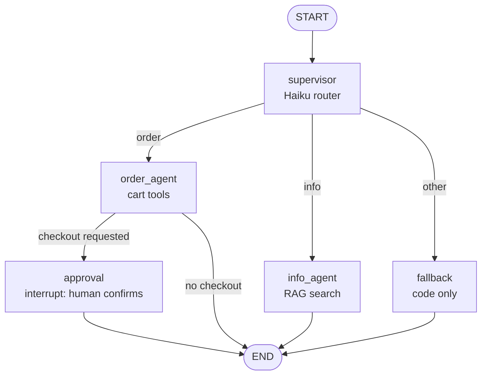

# Burger Ordering Agent: An Agentic AI Architecture Project

A hands-on project exploring how to build **reliable** AI agents: a multi-agent ordering assistant for a fictional burger restaurant, built step by step from a single LLM call to a LangGraph supervisor with specialist agents, hybrid RAG, and human-in-the-loop approval.

The core idea behind every design decision:

> **Treat the LLM as a smart but unreliable component, and build a reliable system around it.**
> The LLM decides *what* to do. Code controls *what it can touch*, holds the state, does the math, and enforces approvals.

---

## Architecture



- **Supervisor** (Claude Haiku): a cheap, fast model that only routes each message.
- **order_agent** (Claude Sonnet): manages a cart through tools. It can only *request* checkout; it cannot place orders.
- **info_agent** (Claude Sonnet): answers allergen, nutrition, and policy questions from documents, with citations.
- **approval**: LangGraph `interrupt()` pauses the graph durably until a human confirms. A checkpointer saves state after every node.
- **fallback**: plain code, no LLM call.

### RAG pipeline (`rag.py`)

```
question → dense search (MiniLM embeddings) + BM25 keyword search
         → Reciprocal Rank Fusion → cross-encoder re-ranking → top 3 chunks
         → relevance threshold: below it, return nothing ("I don't know")
```

---

## Project evolution

| Stage | File | What it adds |
|---|---|---|
| 1 | `day1.py` | LLM order parser with Pydantic schema + business-rule validation and a `clarify` intent |
| 2 | `day2.py` → `day2c.py` | Tool-using ReAct agent → cart in code, checkout with approval gate, unique order IDs |
| 3 | `rag.py`, `day3c.py` | Hybrid RAG service with re-ranking, plugged into the agent as a tool |
| 4 | `day4.py` | LangGraph supervisor + specialist agents + durable human approval |

---

## Key design decisions

- **Validate everything the LLM produces.** Schema validation checks shape; business rules check meaning.
- **State lives in code, not in the conversation.** The cart and placed orders are real objects, the source of truth.
- **Money math happens in code.** The LLM never calculates totals.
- **Least-privilege tools.** `checkout` takes no parameters, so the model cannot change what is charged. Customer identity comes from the session, never from the model.
- **Write actions need human approval, enforced in code and in the graph structure**, not just requested in a prompt.
- **"I don't know" is a feature.** A retrieval threshold stops irrelevant questions before any LLM call.
- **Model tiering.** A cheap model routes; a stronger model reasons; plain code handles fixed replies.

---

## What testing revealed

Real findings from building and red-teaming this project:

1. **Silent failure.** "gimme the usual" produced a valid-looking order with zero items that passed schema validation. Fixed with business-rule validation and a `clarify` intent.
2. **A prompt guardrail failed.** The agent placed an order without asking, despite instructions. The code-level approval gate stopped the charge. This led to the cart redesign.
3. **Retrieval tie.** Dense and keyword search each preferred a different chunk, and RRF tied. Fixed with cross-encoder re-ranking.
4. **Data quality beat retrieval tuning.** Fixing one ambiguous allergen sentence improved an answer more than any search change.
5. **Integration regression.** A safety instruction was lost when merging RAG into the agent.
6. **Multi-agent context bug.** The order agent retracted the info agent's correct answer because shared history had no attribution. Fixed with team-aware prompts; production would add attribution to the state.
7. **Re-execution on resume.** LangGraph re-runs an interrupted node from the top, so side effects must come after `interrupt()`.

---

## Models used

| Model | Runs on | Role |
|---|---|---|
| Claude Sonnet | Anthropic API | Agent reasoning and tool use |
| Claude Haiku | Anthropic API | Routing |
| all-MiniLM-L6-v2 | Local | Embeddings for semantic search |
| ms-marco MiniLM cross-encoder | Local | Re-ranking |

---

## How to run

```bash
python3 -m venv .venv
source .venv/bin/activate
python3 -m pip install -r requirements.txt
export ANTHROPIC_API_KEY=your-key-here     # never commit your key
python3 day4.py
```

---

## Roadmap

- [ ] Automated eval suite: retrieval hit rate, routing accuracy and consistency, LLM-as-judge faithfulness
- [ ] Train a small intent classifier and compare it with the LLM router on accuracy, latency, and cost
- [ ] Attribution of agent messages in graph state
- [ ] Persistent checkpointer (Postgres) and deployment on AWS (Bedrock)
- [ ] Tracing with OpenTelemetry

---

## Disclaimer

This is a personal learning project. All menu items, prices, allergen information, and policies are **fictional** and for demonstration only. It is not affiliated with, endorsed by, or connected to any company or its systems, and uses no real company data or APIs.
