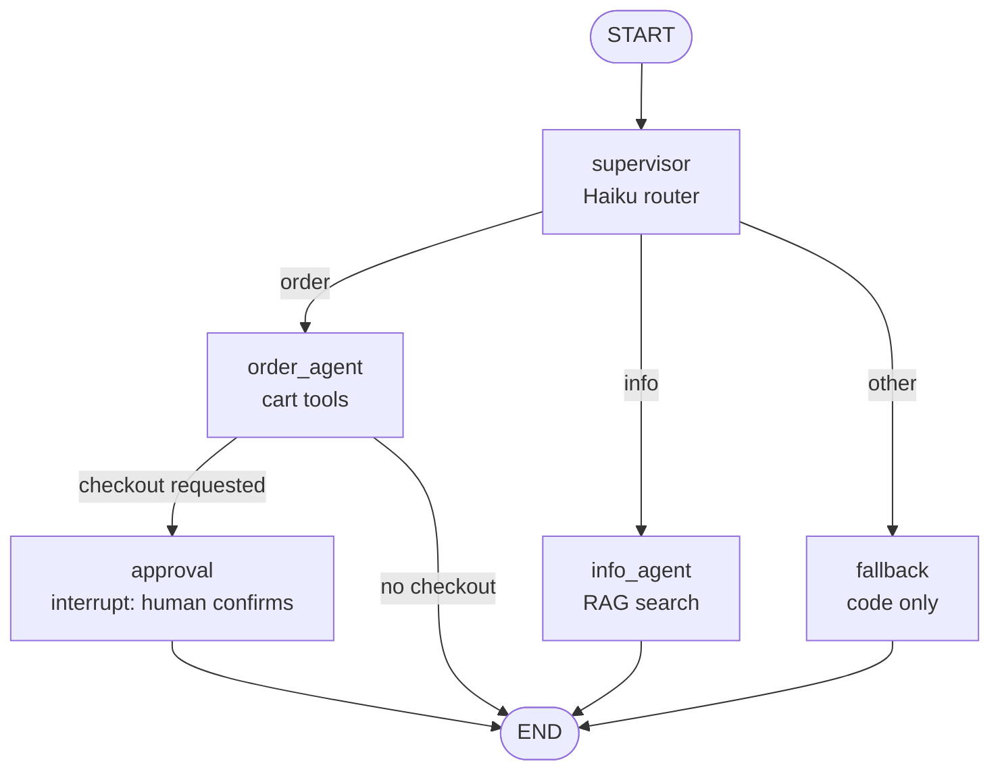

# Burger Ordering Agent: An Agentic AI Architecture Project

A hands-on project exploring how to build **reliable** AI agents: a multi-agent ordering assistant for a fictional burger restaurant, built step by step from a single LLM call to a LangGraph supervisor with specialist agents, hybrid RAG, and human-in-the-loop approval.

The core idea behind every design decision:

> **Treat the LLM as a smart but unreliable component, and build a reliable system around it.**
> The LLM decides *what* to do. Code controls *what it can touch*, holds the state, does the math, and enforces approvals.

---

## Architecture



- **Supervisor** (Claude Haiku): a cheap, fast model that only routes each message.
- **order_agent** (Claude Sonnet): manages a cart through tools. It can only *request* checkout; it cannot place orders.
- **info_agent** (Claude Sonnet): answers allergen, nutrition, and policy questions from documents, with citations.
- **approval**: LangGraph `interrupt()` pauses the graph durably until a human confirms. A checkpointer saves state after every node.
- **fallback**: plain code, no LLM call.

### RAG pipeline (`rag.py`)

```
question → dense search (MiniLM embeddings) + BM25 keyword search
         → Reciprocal Rank Fusion → cross-encoder re-ranking → top 3 chunks
         → relevance threshold: below it, return nothing ("I don't know")
```

---

## Project evolution

| Stage | File | What it adds |
|---|---|---|
| 1 | `day1.py` | LLM order parser with Pydantic schema + business-rule validation and a `clarify` intent |
| 2 | `day2.py` → `day2c.py` | Tool-using ReAct agent → cart in code, checkout with approval gate, unique order IDs |
| 3 | `rag.py`, `day3c.py` | Hybrid RAG service with re-ranking, plugged into the agent as a tool |
| 4 | `day4.py` | LangGraph supervisor + specialist agents + durable human approval |

---

## Key design decisions

- **Validate everything the LLM produces.** Schema validation checks shape; business rules check meaning.
- **State lives in code, not in the conversation.** The cart and placed orders are real objects, the source of truth.
- **Money math happens in code.** The LLM never calculates totals.
- **Least-privilege tools.** `checkout` takes no parameters, so the model cannot change what is charged. Customer identity comes from the session, never from the model.
- **Write actions need human approval, enforced in code and in the graph structure**, not just requested in a prompt.
- **"I don't know" is a feature.** A retrieval threshold stops irrelevant questions before any LLM call.
- **Model tiering.** A cheap model routes; a stronger model reasons; plain code handles fixed replies.

---

## What testing revealed

Real findings from building and red-teaming this project:

1. **Silent failure.** "gimme the usual" produced a valid-looking order with zero items that passed schema validation. Fixed with business-rule validation and a `clarify` intent.
2. **A prompt guardrail failed.** The agent placed an order without asking, despite instructions. The code-level approval gate stopped the charge. This led to the cart redesign.
3. **Retrieval tie.** Dense and keyword search each preferred a different chunk, and RRF tied. Fixed with cross-encoder re-ranking.
4. **Data quality beat retrieval tuning.** Fixing one ambiguous allergen sentence improved an answer more than any search change.
5. **Integration regression.** A safety instruction was lost when merging RAG into the agent.
6. **Multi-agent context bug.** The order agent retracted the info agent's correct answer because shared history had no attribution. Fixed with team-aware prompts; production would add attribution to the state.
7. **Re-execution on resume.** LangGraph re-runs an interrupted node from the top, so side effects must come after `interrupt()`.

---

## Models used

| Model | Runs on | Role |
|---|---|---|
| Claude Sonnet | Anthropic API | Agent reasoning and tool use |
| Claude Haiku | Anthropic API | Routing |
| all-MiniLM-L6-v2 | Local | Embeddings for semantic search |
| ms-marco MiniLM cross-encoder | Local | Re-ranking |

---

## How to run

```bash
python3 -m venv .venv
source .venv/bin/activate
python3 -m pip install -r requirements.txt
export ANTHROPIC_API_KEY=your-key-here     # never commit your key
python3 day4.py
```

---

## Roadmap

- [x] Automated eval suite: retrieval hit rate, routing accuracy and consistency, LLM-as-judge faithfulness
- [x] Train a small intent classifier and compare it with the LLM router on accuracy, latency, and cost
- [ ] Attribution of agent messages in graph state
- [ ] Persistent checkpointer (Postgres) and deployment on AWS (Bedrock)
- [ ] Tracing with OpenTelemetry

---

## Disclaimer

This is a personal learning project. All menu items, prices, allergen information, and policies are **fictional** and for demonstration only. It is not affiliated with, endorsed by, or connected to any company or its systems, and uses no real company data or APIs.

## Evaluation results

`day5_evals.py` runs 24 automated checks against the real system:

| Layer | Grader | Result |
|---|---|---|
| Retrieval (10 questions, incl. paraphrases and unanswerable ones) | Code: expected chunk in top 1 / top 3 | hit@1 10/10, hit@3 10/10 |
| Routing (10 conversations x 3 runs) | Code: expected route + consistency | 10/10 accurate, 10/10 stable |
| Info agent behavior (4 questions, 9 checks) | Code checks + LLM-as-judge faithfulness | 9/9 |

The first run scored 6/9 on the info agent. All three failures were **grader bugs**, not agent bugs: the judge returned empty output (no room left after reasoning) and was missing the source file names the agent cited. The eval also caught a retrieval regression caused by renaming menu items. Lesson: evaluate the evaluator before fixing the system.

## Training lab: trained classifier vs LLM router

`train_router.py` trains a logistic regression head (1,155 parameters) on frozen MiniLM embeddings, then compares it with the Haiku router on the same Day 5 eval.

| | Trained classifier | Haiku router |
|---|---|---|
| Day 5 router eval | 8/10 | 10/10 |
| Avg latency | 42 ms | 788 ms |
| Cost per message | $0 | API tokens |

Findings: 94% on its own held-out split but 80% on the eval (distribution shift); errors came from slang and surface word overlap ("can I get a refund for my last order" routed to order). A confidence cascade sent every message to the LLM because probabilities were uncalibrated. Lowering the threshold after seeing eval results would be data leakage, so the next step is calibration on a separate validation set with more real data.

## Security: red-team results

`day6_security_v2.py` adds edge PII masking, an LLM input guard, and quarantine of suspicious retrieved content, then attacks the system with 8 cases, including **layer-bypass tests** that disable the input guard to prove deeper layers hold.

| Attack | Stopped by |
|---|---|
| Prompt leak / fake admin pricing | Input guard |
| Card number in a message | Edge masking (before graph state and checkpoints) |
| Poisoned document (indirect injection) | Tool-boundary quarantine + security alert |
| Prompt leak, guard OFF | Routing to a code-only fallback node |
| $0 pricing, guard OFF | Least-privilege `checkout` (no price parameter) + approval gate showing the real price |

Score: 8/8. The first version scored 5/6 because a keyword grader mistook the agent's *warning* about a poisoned document for compliance, which was fixed with an LLM judge.

## Observability and cost: Sonnet vs Haiku

`day6_observe.py` traces every graph node, LLM call and tool call (tokens, latency, cost). Findings: the Haiku router was 1% of cost while running on every turn; the Sonnet order agent was 70%; the fixed system prompt and tool definitions, not history, dominated input tokens in short conversations.

Switching the specialists to Haiku cut cost per conversation from about $0.034 to $0.002 (~94%). The trace also showed a behavior change, which exposed a gap: no evals covered the order agent. `day6_order_evals.py` adds code-graded order evals (cart, tool calls, checkout flag), 3 runs per case:

| Model | Order evals | Avg latency | Eval cost |
|---|---|---|---|
| Sonnet 5.5 | 18/18 | 3.7 s | $0.105 |
| Haiku 5.5 | 18/18 | 1.7 s | $0.006 |

Decision: switch to Haiku, with the eval suite as a release gate and more cases needed before production.

## MCP: the burger tools as a Model Context Protocol server

`burger_mcp_server.py` exposes the menu, cart, checkout and RAG search as an MCP server (stdio transport, MCP Python SDK 2.x). `mcp_agent.py` is a host that **discovers its tools at runtime** (`list_tools`, `list_resources`) instead of hard-coding them, and asks a human before `checkout`.

Findings:
- **Rules that must always hold belong in the server.** Moving the tools out of the agent silently dropped an allergy safety line that lived in the old agent's prompt. Fixed in the server: allergen search results now carry a `safety_note`, so every MCP client gets it. The host's checkout approval is UX; server-side confirmation is the real guarantee, since any client can connect.
- **Resources are application-controlled.** The host discovered `menu://items` but never loaded it, so the model rebuilt the menu with many tool calls. Loading the resource into context would be faster and cheaper.
- **Server state must be durable.** The cart and order counter live in process memory, so every new session restarted at ORD-1001. A production server should keep state in a database.
- **SDK versions move fast.** MCP SDK 2.x renamed `FastMCP` to `MCPServer` and `inputSchema` to `input_schema`; the version is pinned in `requirements.txt`.
